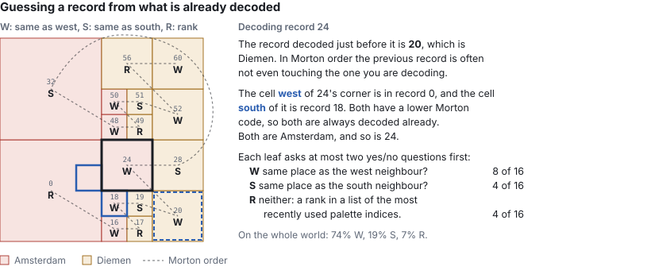
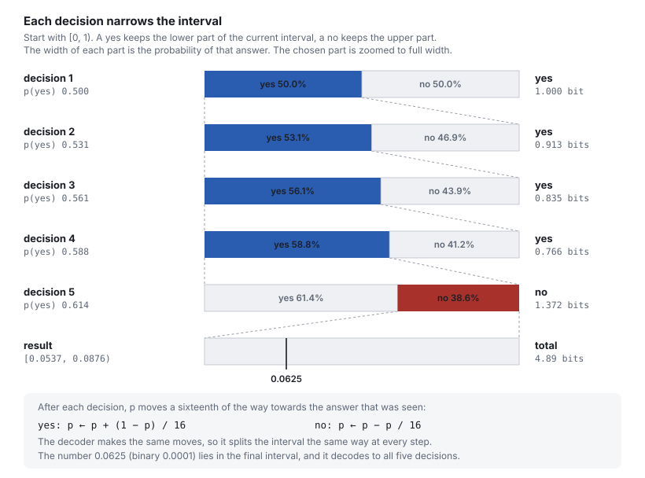

# Beating zlib: the cities of the world in 19.5 MiB

In [my first post about this file format](/tech/compressing-the-world-into-megabytes) I squeezed every country, region and city boundary on Earth into a 72 MiB file. The two fixes that took it to 45 MiB have [their own post](/tech/geodata-72-to-45-mib), and I ended up there with zlib doing the last step. I didn't think there would be something better than this for a while. Then I had an idea, and this is the result: a ~57% reduction in file size. The same format also covers a super-res build of the world, 524,288 × 524,288 cells (275 billion), in 74 MiB. That is sixteen times the cells of the 72 MiB file from the first post, in about the same space. The 19.5 MiB file below is the high-res build, at 131,072 cells across.

## Where version 1 left off

Quick recap: A CGEODATA file is a list of chunks, and every chunk is a [quadtree](https://en.wikipedia.org/wiki/Quadtree) stored in [Morton order](https://en.wikipedia.org/wiki/Z-order_curve) as two parallel arrays: how deep every leaf cell sits in the tree (its *depth*), and which place it belongs to (its *palette index*). The post before this one has the full explanation, and the picture of how a quadtree turns into these two arrays. This is the example chunk it uses, a patch of the world containing Amsterdam (palette index 1) and Diemen (palette index 2):

| | 0 | 16 | 17 | 18 | 19 | 20 | 24 | 28 | 32 | 48 | 49 | 50 | 51 | 52 | 56 | 60 |
| --- | --- | --- | --- | --- | --- | --- | --- | --- | --- | --- | --- | --- | --- | --- | --- | --- |
| **depths** | 1 | 3 | 3 | 3 | 3 | 2 | 2 | 2 | 1 | 3 | 3 | 3 | 3 | 2 | 2 | 2 |
| **palette indices** | 1 | 1 | 2 | 1 | 2 | 2 | 1 | 2 | 1 | 1 | 2 | 1 | 2 | 2 | 2 | 2 |

The numbers on top are the Morton codes of the records. In version 1 we dropped them already: the depths and the palette indices of a chunk were written one array after the other, and deflated as one block. Before them comes the palette, a list of place ids stored as delta-coded varints, where small deltas are much more common than large ones.

## Can we beat zlib with our own compression?

Zlib is a general purpose compressor. The start of every chunk is mostly varints, where lower numbers are more likely since cities in regions are located close together. To zlib these look like "random" bytes, and it has no idea that structured data follows them. I worked together with Claude Opus, Sonnet and Haiku on experiments with different ideas I had.

The result of this is [CGEODATA version 2](https://github.com/ferrybig/loc-to-city/pull/9). The records are exactly the same records as in version 1, but this time we only need 1.34 bits to store 110,148,645 records instead of the 3.31 bits from before. Three changes made this possible:

### Step 1: Don't store depths, store the quadtree

The depths array is a pre-order listing of a quadtree, and a quadtree can be written down with a single yes/no question per node: *does this cell split into four?* For the Amsterdam and Diemen example from earlier, walking the tree from the root:

| Cell               | Type  | Split (*bit*) | Records                |
| ------------------ | ----- | ------------- | ---------------------- |
| root               | split | 1             |                        |
| - - south-west     | leaf  | 0             | record 0               |
| - - south-east     | split | 1             |                        |
| - - - - south-west | split | 1             | records 16, 17, 18, 19 |
| - - - - south-east | leaf  | 0             | record 20              |
| - - - - north-west | leaf  | 0             | record 24              |
| - - - - north-east | leaf  | 0             | record 28              |
| - - north-west     | leaf  | 0             | record 32              |
| - - north-east     | split | 1             |                        |
| - - - - south-west | split | 1             | records 48, 49, 50, 51 |
| - - - - south-east | leaf  | 0             | record 52              |
| - - - - north-west | leaf  | 0             | record 56              |
| - - - - north-east | leaf  | 0             | record 60              |

That is 13 *bits* for what used to be 128 bits (16 bytes) of depths. A cell at the maximum depth cannot split, so it does not even get a question. Even for this small example, that is already a reduction of 9.8×.

Those 13 bits are still not stored as 13 bits. Each question is asked with some knowledge of what was already decoded: the depth of the node, and whether the records to the west and south of it are deeper than it. If your neighbours had to split to follow a border, there is a good chance you have to as well. If your neighbours are big cells, you are probably in the middle of a city and you are probably a big cell too.

### Step 2: Guess the palette index from the neighbours

This is the part I did not see coming. In my head, I was thinking of run length encoding, which is just adding counters after every data byte to mark how often they happen. But in Morton order, the record decoded just before you is often not even touching you: the Z-curve jumps around. What *is* always decoded before you are the cells directly to your west and south, because they have a lower Morton code.



So every leaf asks, in order:

1. Is it the same place as my west neighbour? In the world file, this is yes for 74% of the records.
2. If not: is it the same place as my south neighbour? Yes for another 19%.
3. If not: which one is it? (the remainder 7% of the cases) This is coded as a position in a [move-to-front list](https://en.wikipedia.org/wiki/Move-to-front_transform) of palette indices, where the most recently used index is at the front. The west and south answers are skipped in that list, since we already know it is neither of them. The position is written in [Elias gamma](https://en.wikipedia.org/wiki/Elias_gamma_coding), so small numbers are short.

The decoder finds the neighbours cheaply: for every row and every column of the chunk, it remembers the last record it decoded there. In Morton order, the last record in your row is the one directly to your west.

### Step 3: A range coder instead of zlib

After steps 1 and 2, a chunk is nothing but a long list of yes/no decisions. Those bits are then fed into a [range coder](https://en.wikipedia.org/wiki/Range_coding), the same kind as the one inside [LZMA](https://en.wikipedia.org/wiki/Lempel%E2%80%93Ziv%E2%80%93Markov_chain_algorithm) (and so in `xz` and 7-Zip). A range coder is a form of arithmetic coding: every decision comes with a probability, and a decision that was very likely costs very little, less than a bit:

| Chance the guess is right | Cost when it is right |
| --- | --- |
| 50% | 1 bit |
| 90% | 0.15 bits |
| 99% | 0.015 bits |
| 99.6% (the most the format allows) | 0.005 bits |

The probabilities are not stored anywhere. Every one starts at 50% and moves a sixteenth of the way towards each answer it sees, in the encoder and the decoder alike, so they learn the chunk while it is being decoded. And there is not one probability per kind of question, but one per *situation* (the format calls these contexts): "same as west?" has a separate probability for every depth, combined with whether the west and south neighbours agree with each other, and whether the previous record agreed with either of them. Deep inside a city, where both neighbours and the previous record are all the same place, the "same as west?" probability for that situation is pushed to its limit, and a record costs about 0.005 bits. That is a run-length encoding without ever writing down a run length.



Why not Huffman? A Huffman code spends at least one whole bit for every symbol it writes. Huffman coding the depths and the palette indices separately costs at least two bits per record, already more than the 1.34 bits version 2 spends on both. Claude's experiments showed that range coding gave the largest compression.

| Variant                                       | Size                   |
| --------------------------------------------- | ---------------------- |
| v1 chunks, zlib                               | 43.5 MiB (chunks only) |
| v1 chunks, Zopfli (a better deflate encoder)  | 35.7 MiB (chunks only) |
| split flags + neighbour guesses, zlib         | 28.8 MiB (chunks only) |
| split flags + neighbour guesses, range coded  | 17.6 MiB (chunks only) |

#### The range coder, step by step

The probabilities are 12-bit integers, out of 4096, and `p` is always the chance that the decision is a `0`. The decoder keeps two numbers: `range`, the width of the current interval, and `code`, where the encoded number sits inside that interval. To decode one decision with probability `p`:

```text
bound = (range >> 12) × p
if code < bound:  bit = 0,  range = bound
else:             bit = 1,  code = code − bound,  range = range − bound
```

The lower part of the interval is the `0` and has size `p / 4096` of the whole, the upper part is the `1`, and the decision picks which part to keep. This is the interval splitting from the diagram, written with integers. When `range` falls below 2²⁴, the decoder shifts in one more byte of the stream, so whole bytes are only read once their leading bits are settled. That is how a decision costing 0.005 bits can share a byte with its neighbours.

The cost follows directly from the size of the part kept. At 99.6% (`p = 4081`), a decision that goes the likely way keeps 99.6% of the interval and costs about 0.005 bits. One that goes the unlikely way keeps 0.4% and costs about 8 bits. The probabilities learn the chunk as it is decoded, so the common case is cheap and the rare case pays for it.

#### Watch it work

Reading about it only goes so far, so here is a small demo that shows how it works. Notice how it goes from the records to the small lookup table, then into the range coder. The range coder doesn't help a lot here, but with a larger dataset it learns more as it goes on for longer. (See the real chunk at the end of this post.)

<geodata-range-coder mode="encode" example="blog">


</geodata-range-coder>

The decoder goes the other way: it starts with nothing but the bytes, the number of records and the size of the palette, and rebuilds the records from them. It runs the same code as the encoder, so at the last step it shows the same records as the encoder does.

<geodata-range-coder mode="decode" example="blog">

The decoding simulation needs JavaScript.

</geodata-range-coder>

<script async type="module" src="../../../simulations/geodata-range-coder/dist/geodata-range-coder.js"></script>

The example is tiny, so it costs 4.5 bits per record instead of the 1.34 of the real file, and 5 of its 9 bytes are only there because the encoder has to flush its registers. The probabilities don't have enough records to learn from.

## The price: decode speed

I predicted bits would be slower, and it indeed was. Where before things could be processed in parallel, now every decision depends on the one before it, so there is nothing to vectorise, and it takes about 2.5 decisions per record. zlib's inflate on the other hand is native code that has been optimised for decades.

| Operation                       | v1          | v2                                            |
| ------------------------------- | ----------- | --------------------------------------------- |
| decode every chunk of high res  | 1.0-1.2 s   | 4.7-5.1 s (WebAssembly), 11-12 s (JavaScript) |
| 32 tile burst, initial view z10 | 195 ms      | 212 ms                                        |
| 32 tile burst, europe z4        | 1004 ms     | 3308 ms                                       |
| cold query Paris / Tokyo        | 11.3 / 3.5  | 28.6 / 9.9 ms                                 |
| encode every chunk, one thread  | 100 s       | 11 s                                          |

The hope of winning speed back by dropping zlib only came true on the encoding side: the compressor is 9 times faster at writing chunks than zlib at its highest level.

Remember the [WebAssembly decoder I removed as part of the version 1 upgrade?](/tech/geodata-72-to-45-mib#do-we-actually-need-to-store-the-morton-codes) For version 2 I decided to bring it back, because here it is 2.4 times as fast as the JavaScript decoder. It follows the same rules as the version 0 decoder: it can only accept or decline a chunk, never report an error, and the JavaScript decoder stays the reference. A test feeds both 8,000 corrupted streams and checks that WebAssembly never accepts one that JavaScript rejects.

The slowdown matters less as querying is human paced. If someone prefers a fast lookup speed over disk space, they should a non compressed representation of the current format. Defining a file format for this is a future task

## How close is the actual implementation to my original idea?

| My original idea | What Claude actually built | Verdict |
| --- | --- | --- |
| A Huffman tree built from how often each palette index is used | Adaptive arithmetic (range) coding, where probabilities are learned while decoding and nothing is stored | Same family, one step further: fractions of a bit, and no tree per chunk |
| Run-length encoding | No runs at all, but "the previous record agreed" is part of the context, so a long run costs ~0.005 bits per record | Same effect, different mechanism |
| QOI's "take the last X you output" | "Same as west", "same as south", and otherwise a position in a move-to-front list | The closest match. QOI keeps a table of recently seen pixels; the move-to-front list is recently used palette indices |
| Store depths in fewer bits than a byte | Depths are not stored at all, only one yes/no split flag per node | Further than my idea |
| Do it for both the depths and the palette indices | Both | Yes |
| The palette itself (the list of place ids) | Unchanged, still delta-coded varints | Not touched |
| Bits instead of bytes will be slower | About 4 times slower to decode with WebAssembly, about 10 times with plain JavaScript | Correct |
| Maybe faster because there is no zlib | Encoding is about 9 times faster, decoding is slower | Half right |

## Watch it decoding a real chunk

The examples above have 16 records. A real chunk has thousands. This is chunk 207623 of the super res world file, the tile that runs from the eastern edge of Amsterdam, over the Markermeer, to Lelystad and Hoorn. It is 6,052 bytes in the file: 89 bytes of palette and record count, and a range coded stream of 5,963 bytes for 35,422 records. This specific chunk ends up 1.35 bits per record, right at the average of the whole file.

<geodata-real-chunk>

The simulation of this chunk needs JavaScript.

* **The records** fill in from the south-west corner in Morton order, and the black square is the cell the decoder is asking about. Big areas of one place take a few records, and the borders between places take thousands of tiny ones.
* **The stream** is a tape that slides past the read head. The bytes on the left have been read, and the four that are outlined are the ones the decoder holds in `code` right now. The tape moves about one byte for every six records.
* **The probabilities** are the ones from step 3, with the context in brackets: `split` is "does this cell split?", `sameWest` and `sameSouth` are the neighbour guesses, and `rankLength` is the start of the move-to-front rank. The bar is the chance of a `0`. This chunk only ever uses 276 of the 2,496 probabilities the format has, and the list shows the 12 that decide the most.

</geodata-real-chunk>
