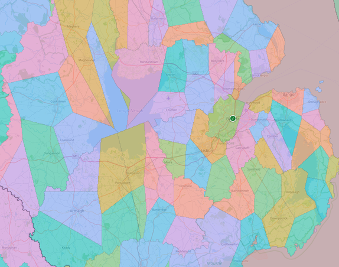
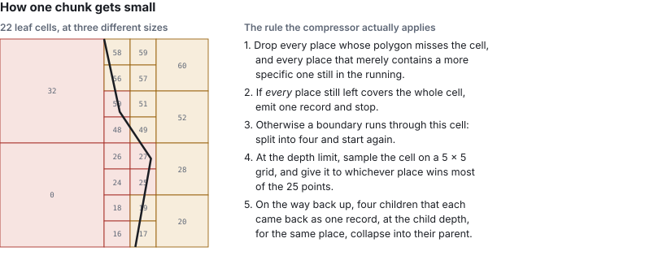
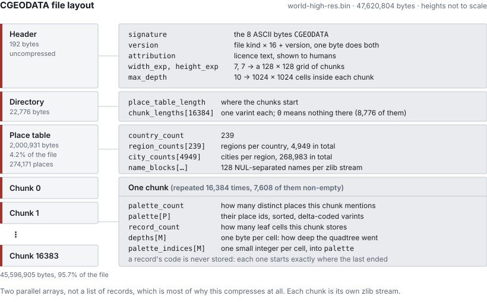

# Compressing the cities of the world into a mere 45 megabytes

I started [loc-to-city](https://github.com/ferrybig/loc-to-city) because my favorite photo manager kept telling me the wrong city. It has since turned into something I keep reaching for in other projects, so this post is about the tool and the file format it produces, not about the photo manager. The headline I still find hard to believe: every country, region and city boundary on Earth, at a resolution of roughly 300 by 150 metres, in a single 45 MB file that answers a lookup without ever reading more than a small slice of it.

Every colleague I showed this to guessed the file would be ten to a hundred times bigger, so somewhere between 1 GB to around 10 GB. That is a fair guess for the obvious approaches: shipping the polygons themselves costs around 5.5 GB according to the filtered polygon list.
## What the tool actually is

Five TypeScript packages.

* **data-ingest**: Takes the extracted OSM data and filters it (with as manythreads as you have cores)
* **compressor**: Takes the filtered OSM data and builds a `.bin` file (with as many threads as you have cores)
* **reader**: Designed to read the `.bin` file
* **verify**: A verification tool and scripts for all the findings, designed to prevent regressions when tuning things (this has happened *a lot*!)
* **demo**: A [ExpressJS](https://expressjs.com/) webserver that runs a tile server based on the `.bin`
 
The one that matters to users is **reader**, published as `@ferrybig/cgeodata-reader`, which has zero 3th party runtime dependencies (note that it uses either node [`zlib`](https://nodejs.org/api/zlib.html) or the browsers [`CompressionStream`](https://developer.mozilla.org/en-US/docs/Web/API/CompressionStream)).

The format of the `.bin` file is documented at, [binary-format.md](https://github.com/ferrybig/loc-to-city/blob/master/reader/binary-format.md), I decided to work on the format first before making implementations. There has been 1 version bump in the binary format, when I realised I didn't need to include morton codes and a marker for "no result", I only needed to include one of the 2, I kept the no result marker.

## Why not just store one point per city?



Cities are not points. *They are irregular polygons*, and a big city's label point is often further from you than a small neighbour's label point even while you are standing well inside the big city. In this tool, we only fall back to cities as points when there is no better polygon source. When seeing cities as points, there are a lot of places that go wrong, for example

```
52.034656, 4.388124  is Den Haag, not Nootdorp
51.970738, 4.123725  is Europoort, not Hoek van Holland
52.683459, 5.295410  is Lelystad, not Enkhuizen
```

The last case is my favorite. It looks "wrong", but if you look at the municipal border records, it is actually correct. The border of Lelystad goes over the water to the edge of the provincial border.

## Why not store the polygons then?

The first off, they are 5.5GB uncompressed for worldwide coverage. It likely can be compressed to 500 MB with standard compression algo's (unverified claim), but this is still a lot of data. While a single polygon can be simplified, it is hard to do correctly.. During the development of the file format, I played around with simplified polygons for large countries like Russia and Germany. This created artifacts in the data that were unwanted.

During development I benchmarked four approaches against each other on just *the Netherlands*, with exact point-in-polygon as the ground truth:

| | Approach | On disk(uncompressed) | Accuracy | Query |
|---|---|---|---|---|
| A | Nearest labelled point | 55 KiB | 26 to 46% | ~14 to 21 µs |
| B | Exact point-in-polygon | 41.5 MiB | 100% (it *is* the truth) | ~24 to 41 µs |
| C | Adaptive grid, polygons as fallback | 0.60 MiB + the polygons | 100% | ~6 µs inside, ~39 µs near a border |
| D | Adaptive grid, ambiguity resolved at build time | 0.54 MiB, nothing else | ~97% | ~7 µs |

D won, and the interesting part is *why* it won on size. C and D store the same grid. The difference is that C keeps the polygons around so it can fall back to exact maths at a border, and D decides the border cells once, while building, and then throws the geometry away.

**The shipped file contains no polygons at all**, not a single polygon. The reader never sees a coordinate pair that wasn't a query. That is the single biggest reason the format is small, and we can only choose it because we are willing to be approximately wrong in a thin band along every border.

## So what is in there instead?

A list of chunks, containing a [quadtree](https://en.wikipedia.org/wiki/Quadtree), flattened.

Take a square patch of the world and ask which places overlap it. Throw away the ones whose polygon misses it entirely, and the ones that are only in the list because they contain something more specific that is also in the list, since a province is irrelevant here if one of its own cities is still in the running. If *every* place that survives covers the whole patch, write one record for it and stop. Otherwise somebody's boundary runs through the patch, so cut it into four and start again. At the depth cap we cannot split any further, so we sample the cell on a 5 × 5 grid and give it to whichever place wins most of the 25 points.

The condition for stopping is worth being precise about. It is not "one place wins the cell". It is "no boundary passes through the cell". A cell that is 99% Amsterdam and 1% Diemen is *not* finished: it gets split, and so do its children, all the way down. Then, on the way back up, four children that all came back with the same answer collapse into one record for their parent.

Then number every leaf cell with its [Morton code](https://en.wikipedia.org/wiki/Z-order_curve) (interleave the bits of its row and column) and sort. Morton order is quadtree order, so a sorted list of codes *is* the tree, and a lookup is one binary search over integers.



Written out as two parallel arrays:

| | 0 | 16 | 17 | 18 | 19 | 20 | 24 | 28 | 32 | 48 | 49 | 50 | 51 | 52 | 56 | 60 |
|---|---|---|---|---|---|---|---|---|---|---|---|---|---|---|---|---|
| **depths** | 1 | 3 | 3 | 3 | 3 | 2 | 2 | 2 | 1 | 3 | 3 | 3 | 3 | 2 | 2 | 2 |
| **palette indices** | 1 | 1 | 2 | 1 | 2 | 2 | 1 | 2 | 1 | 1 | 2 | 1 | 2 | 2 | 2 | 2 |

Codes 24 and 56 are both merges of four cells. The boundary still crosses 24, but all four of its children went to Amsterdam anyway.

Note that mostly ones, twos and fours, in long runs, which is what zlib is good at. Interleaved as 16 fixed-width records it would have had nothing to find.

The thing that makes this cheap is in the left half of that picture. A record costs the same whether it covers one cell or a quarter of the chunk, so the inside of a city is nearly free, and only the boundary is expensive. Boundaries are one-dimensional and area is two-dimensional, so we end up paying for the perimeter of the world's cities rather than for their surface.

### The step 5 merging step

A fun fact, step 5 of that article is only a recent change, I realized something important during the writing of this blog posts. Initially, once a cell was divided to the maximum, it was kept that way, **once a cell had been split, its children were never merged back.**. Four siblings that all resolved to the same place stayed four records, even though the parent cell covers exactly the same ground and gives exactly the same answer.

I talked with Claude Opus about this, Opus didn't think it would be a significant improvement, because zlib's repeating value compression would see the pattern. My gut feeling was different, I didn't think of zlib, but just for 75% space saved for the records in questions. After testing, on the worldwide file as it then stood, a single bottom-up merge pass would have removed 45,954,924 of 166,081,761 records.

After the merge cascades build finished, I realized where both I and claude where wrong, namely because a merged parent can itself become one of four mergeable siblings, so even though the numbers didn't look great initially, the real reduction is **36.0% of the records, 166,081,761 down to 106,377,942**. And the file:

```
                 before        after
records     166,081,761  106,377,942   -36.0%
bytes        75,935,694   64,244,778   -15.4%
chunk bytes  73,911,162   62,220,461   -15.8%
```

zlib's loss on the shortened runs is real but small next to the win from dropping a third of the varint deltas: 5,748 chunks got smaller, 15 got bigger. Lookups got faster too: a cold query in the densest chunk went from 17.9 ms to 9.5 ms, because there is a third less to decode.

The subtle part is the condition. It is not enough that four children each came back as a single record for the same place; they must each be a record *at the child depth*. A child that only one place touches a corner of also comes back as exactly one record, but a smaller and deeper one, and merging four of those hands the place all the empty cells in between. On the first worldwide build that invented 88,542 records of ocean, caught only because the output disagreed with an independent simulation by exactly that count.

### Do we actually need to store the morton codes?

As I was reviewing [the Claude drafted svg](https://github.com/ferrybig/www.ferrybig.nl/blob/9bdd8b81b7d8c47672eddfd68d5b4732be2c08eb/content/tech/compressing-the-world-into-61-megabytes/quadtree-to-columns.svg) of the quadtree, I realized another aspect. Looking at the "array" section, the depth and the codes have relationships! If depth is 1, the next code is 16, If depth is 2, the next code is 4, if depth is 3, the next code is 1. The only thing that ever broke the pattern was a gap, a stretch of unplaced cells between two records. Make the gap an explicit record instead of a silent skip, and there is nothing left for the codes array to say that the depths array does not already say: a reader can get a cell's code by walking the chunk and adding up depths as it goes.

That became [CGEODATA version 1](https://github.com/ferrybig/loc-to-city/pull/7): the codes array is gone, and an empty stretch of cells is now an explicit "no place" record instead of a silent skip. Measured on the real rebuilt file, not a prototype:

```
             v0, codes stored   v1, codes derived
records          106,377,942          110,148,645    +3.5%
bytes             64,244,778           47,620,804   -25.9%
chunk bytes       62,220,461           45,596,905   -26.7%
```

The extra 3,770,703 records are the gaps, which used to cost nothing and now cost one record each. They are cheap anyway: a long run of identical depths and index-0 palette indices is exactly what zlib likes. Losing the codes array outright pays for them several times over.

I asked claude to make a version 1 chunks WebAssembly decoder version 0 already had, then reverted it a day later. Measured across the whole file, deriving codes in WebAssembly instead of plain JavaScript saved about 16 microseconds per chunk, not enough to justify a second compiled decoder and its own fuzz tests. Version 0 files still decode through WebAssembly; version 1 does not. The honest cost of that shows up in a cold lookup: Paris, which used to resolve in 9.5 ms, now takes about 13 ms, because the arithmetic a compiled module used to do now runs as plain JavaScript on every chunk a query happens to land in. The file got smaller and a cold query got slower, in the same release. Even then, 13ms is pretty fast considering how often geocoding happens...

## How does 17 billion cells fit in 45 MB?

Let me do the arithmetic that makes this sound impossible first.

The worldwide file uses a 128 × 128 grid of chunks and a quadtree depth of 10, which works out to 131,072 × 131,072 cells across the planet. That is **17,179,869,184** cells, each about 306 m wide and 152 m tall at the equator. There are 274,171 distinct places, so a place id needs 19 bits. If we stored one id per cell we would need

```
17,179,869,184 cells × 19 bits = about 40 GB
```

Nobody would ship that. It is just the upper bound the grid starts from, before any of the structure below is applied. The actual file is 47,620,804 bytes, so **857 times smaller** than the dense grid, and 115 times smaller than the 5.5 GB of polygons it was built from.

Where does it go? The quadtree collapses those 17.18 billion cells into **110,148,645 records on disk** — 106,377,942 real places plus 3,770,703 explicit gaps, now that a gap needs its own record rather than a skipped code — a factor of 156 on its own. Then those records are stored in 47.6 MB, which works out to **0.43 bytes per record**: a depth and a place reference, well under half a byte each.

Three things get us there. The prototype measured the last two on a 954,497-record dataset, so I can put real numbers on them:

1. **Don't store cells, store leaves.** The quadtree collapses every uniform area into one record. This is the big one, and it is the one that makes the other two possible.
2. **Delta-code the sorted codes as varints.** Consecutive Morton codes are close together, so most deltas fit in one or two bytes instead of a fixed eight. The code stream went from 7.6 MB to under 1 MB, and the whole blob from 7,744,895 bytes to 3,824,888. (The shipped format has since gone one step further and dropped codes from storage entirely — covered above.)
3. **Then zlib it.** 632,143 bytes, 12× smaller than the naive fixed-width encoding with the drawback of loosing random access

The step I did not expect to matter is hiding in there, and it does not show up on its own: **storing the two ~~three~~ arrays separately rather than as a list of records.** That change is free. The same numbers go into the file in the same order, just grouped by kind instead of by record, so it saves nothing at all before compression. What it does is put all the depths next to each other, and all the palette indices next to each other, and all the small deltas next to each other, so the compressor finally has runs to find instead of a stream of interleaved unrelated bytes. Reordering nothing is what made step 3 worth 6×.

## Why deflate, when zstd exists?

let me answer that with a table

| Method       | Size     | NodeJS support | Browser supported |
|--------------|----------|----------------|-------------------|
| Uncompressed | 247.8 MB | yes            | yes               |
| Deflate      | 45.6 MB  | yes            | yes               |
| Gzip         | 45.7 MB  | yes            | yes               |
| Brotli       | 38.7 MB  | yes            | partial           |
| Zstd         | 38.8 MB  | experimental   | no                |
| xz           | 37.5 MB  | no             | no                |

I used deflate anyway, because any compression with the delta-varint columnar layout had already captured most of the available gain, and because deflate is a compressor that is built into both Node.js (`zlib.inflateSync`) and every browser (`DecompressionStream('deflate')`). Paying a native addon or a WASM blob as a dependency, in exchange for 18%, in a library whose entire selling point is that it has no dependencies, was not a trade I wanted.

## What does the file look like?

Four sections, no padding, no trailer. Designed for replacing on update



The directory is the part that makes partial reads work. It lists the byte length of every chunk, in order, so a reader sums the prefix once at load time and then knows exactly where any chunk lives. A length of `0` means that chunk is empty and nothing is stored for it at all, which is how the oceans cost almost nothing: 8,776 of the 16,384 chunks are empty.

The place table is the other surprise. All 274,171 names, with their hierarchy and their alternative spellings, are 2,000,931 bytes. **4.2% of the file.** The hierarchy itself is almost free because it is never stored as parent pointers: places are numbered so that all countries come first, then all regions grouped by country, then all cities grouped by region, and the file only records *how many children each parent has*. Parent lookup is a binary search over a prefix sum.

Names are split into blocks of 128 and each block is deflated separately, so recovering one name means inflating about two kilobytes rather than two megabytes. I tested several block sizes on the worldwide file:

| Names per block | Place table | Resolving one place | Scanning every name |
|---|---|---|---|
| 8192 | 1.64 MB | 4.9 ms | 134 ms |
| 512 | 1.82 MB | 0.9 ms | 141 ms |
| 128 | 2.05 MB | 0.7 ms | 152 ms |
| 32 | 2.53 MB | 1.4 ms | 210 ms |

128 is the sweet spot. Below that the per-block zlib framing and the longer length table start costing more than the finer granularity saves.

## How is a lookup fast when the file is 45 MB?

It never reads the full 45 MB. A lookup reads the header and the directory once (about 23 KB), and after that it reads exactly one chunk, inflates it, and binary searches it. Most chunks are a few kilobytes; the very worst one in the world, a square covering Belgium and the French border, is 155 KB compressed and holds 270,514 records. Nothing else in the file is touched.

From the benchmark suite, on the worldwide file:

```
open                                     10.30 ms
query, cold   Paris / Tokyo / Amsterdam  13.03 / 3.56 / 3.77 ms
query, warm                               0.06 ms
search "berlin" --sort, cold / warm      37.04 / 1.70 ms
300 cold lookups, concurrent            192.08 ms
memory after open                         100 MB RSS
```

The cold numbers are entirely "how big is the chunk the query landed in". Paris is in a dense chunk; Amsterdam is not. Once a chunk is decoded it stays in an LRU cache, and then a lookup costs well under a tenth of a millisecond, which is why the map tile renderer in the demo is usable at all: neighbouring pixels share a chunk.

## How can search be fast when it matches anything?

This was the part I expected to be easy and wasn't. `search("dam")` should find Amsterdam, Zaandam and Rotterdam. `search("munchen")` should find München. Substring matching, diacritic-insensitive, over 274,171 places, each with several alternative names. The naive version inflates and scans every name in the file, which is not fast.

The answer is a **trigram index**, shipped as an optional sidecar file. Every run of three consecutive characters in every name gets a list of the places that contain it. A query of three or more characters only has to intersect the lists of its own trigrams, and only places present in *all* of them can possibly match.

Two details make it actually work:

* **The lists are allowed to be wrong in one direction only.** Every stage of the folding (strip diacritics, lowercase, bucket all digits together, bucket all punctuation together) is many-to-one, so the candidate set is always a superset of the true matches. The reader then confirms every candidate by comparing the actual names, exactly as it would without an index. A corrupt or stale index can make a search slow or make it miss things; it can never make it return a wrong answer.
* **Hashing instead of on making a naive pool on latin only letters** of 32,768 lists, alongside the 21,952 lists that the 28 Latin symbols generate on their own. The earlier version mapped every non-Latin letter to a single "other" symbol, which meant a three-letter Cyrillic query left all 36,000-odd non-Latin cities as candidates. Hashing fixed that without making the file meaningfully bigger.

What about one- and two-character queries, which have no trigram at all and match nearly everything? We cannot index our way out of that, so the file just stores the answer: for every one- and two-character string that occurs anywhere in any name, the top five places in relevance order, precomputed. 25,497 keys, about 365 KiB, binary searched by key.

The whole search index is 4.26 MB against a 45 MB main file. Measured end to end, opening both files fresh for every query:

| | 1 char | 2 chars | 3 chars | 5 chars | 8 chars |
|---|---|---|---|---|---|
| With the index | 11 ms | 10 ms | 26 ms | 13 ms | 12 ms |
| Without | 181 ms | 141 ms | 138 ms | 136 ms | 135 ms |

Intersecting the lists takes well under a millisecond. Everything in the three-character column is the cost of *confirming* candidates, because the commonest trigrams still have thousands of them, and confirming one means inflating the name block it lives in. Which is how the block size experiment above ended up mattering far more than the index did.

## How do I know any of it is right?

I don't, which is why there is a 3,000-line file called [countries.md](https://github.com/ferrybig/loc-to-city/blob/master/countries.md) with a section per country and a status marker on every finding: *fixed*, *open*, *unsolvable*, *false positive*, or *human error*. Currently 52 open and 4 unsolvable.

Almost all of it was found by staring at the demo's tile overlay, which paints each cell by the city it resolves to. Wrong data looks wrong immediately in a way it never does in a table. I tried to find ways to automate this and eventually I created the "verify" package. This package contains verification tests. It also contains test like counting the "islands" of a city. A high island count either happens in the country of [Fr. Polynesia](https://geodata.ferrybig.nl/#map=12/-16.8942/-144.6642) or whe multiple city polygons overlap and every "cell" switches order

A sample of what is actually out there:

**"City" doesn't mean anything.** There is no administrative level that means "city" worldwide. The Netherlands has survey-grade `admin_level=10` boundaries straight from the national address register. Most of the US resolves at the county level. France uses communes, Australia gazetted localities. Picking the right level per country is a 112-section research problem and it is most of the project's actual difficulty.

**Picking the level by coverage is a trap.** Germany's ordinary municipality level covers 96% of the country's land area, so by any coverage metric it is done. It also excludes all ~107 *kreisfreie Städte*, the cities that are legally their own district, which is where a third of the names anyone would search for live. That is why there is a separate spot-check that queries capitals and major cities by name rather than trusting a percentage.

**Capitals often aren't cities.** Vienna, Prague, Minsk, Kyiv, Moscow, Berlin, Washington DC: in OpenStreetMap these are *region*-level units with nothing beneath them, so a lookup can correctly say "the region of Vienna" and never "the city of Vienna", because no such polygon exists. There is now a hand-reviewed list that re-emits the region's own polygon as a city of the same name, which fixed 24 capitals in one pass. It does not fix Tashkent, Yerevan or Astana, where the level below the capital-region isn't empty, it is a grid of districts with entirely different names. There is simply no shape anywhere in the data that means "the capital, as a city".

**Dependencies overlap their parents, and something has to win.** Puerto Rico's outline is drawn inside the United States' outline; Hong Kong's inside China's. Both claim the same land, in the source data, literally. Left alone, the "largest area wins" tie-break flipped 543 cities to the parent country. There are 39 such overlaps and each now has a declared owner, derived from whichever country the city and region lookups already name on that ground.

**Some places have no answer, and that is correct.** Bir Tawil, a 2,000 km² strip between Egypt and Sudan, is claimed by neither country, because each prefers a different disputed triangle instead. It resolves to no country at all. It is filed as a *false positive*: it looks exactly like a bug and it is the only right answer.

**Some places have no answer, and that is just a loss.** Shire and Yebokile in Ethiopia have no boundary polygon of any kind finer than the region. Nothing can be done without falling back to nearest-point, which is the precise failure mode this whole project exists to avoid. Filed as *unsolvable*.

**And occasionally the data is just a record of something else.** The West Bank's administrative relations are drawn as the Oslo Accords' Areas A, B and C plus Hebron's H2 zone: hundreds of genuinely disconnected enclaves. The internal tool that flags broken geometry by counting how many disjoint pieces a place has (1 to 4 is normal, 50 or more usually means two shapes are fighting over the same cells) reports Palestine as the most fragmented place on Earth: 5 cities in 289 pieces. The tool is wrong and the geometry is right, and I had not expected a political settlement to show up as a metric in my build pipeline.

## Things that surprised me

* **Simplifying the polygons made the output file bigger.** I was simplifying region boundaries at a ~1.1 km tolerance to keep build times sane. Turning that off entirely took the worldwide file of the day from 75.7 MB to 73.0 MB, and from 166.8 to 159.4 million records, because simplified neighbours overlap each other, and every overlap is an ambiguity that forces extra subdivision to resolve. It also un-broke Campione d'Italia, Vatican City and Monaco, which had been simplified into slivers too coarse to contain their own cities.
* **Chasing precision made it worse too.** The first design pushed every ambiguous cell down to a ~10 m floor. 17.7 million records, 135 MB, which lost to the 112 MB baseline it was supposed to beat. Capping the recursion much shallower and resolving what is left at build time is the entire difference between a failed prototype and a working format. But then things happen and another discovery is made that makes the output file smaller...
* **45% of the build was a single function call.** A CPU profile showed nearly half of all samples inside `@turf/intersect`, running exact arbitrary-precision arithmetic, called only to decide which candidate covered the largest share of an ambiguous cell. Replacing it with a 5 × 5 grid of sample points gave byte-identical output at roughly 5× the speed, because the question never needed an exact area in the first place.
* **The thing that looked like an afterthought was the file.** In one early Europe build, the compressed spatial index was 4.5 KB and the *uncompressed city name strings* were 7.42 MB: 99.94% of the file. Compressing the part I had never thought about made it 4.5× smaller.
* **One hardcoded constant deleted Ireland.** An assumption that counties live at `admin_level=4` silently dropped 54,361 Irish city candidates, plus most of Estonia and Portugal. Ireland uses level 6.
* **Async made it slower.** Running zlib asynchronously, which looks like the obviously correct non-blocking choice, made the tile-burst benchmark 15 to 40% worse. Async file reads cost about 10% and were worth keeping; async inflate was not.
* **Turf.js gave wrong answers at country scale.** `booleanContains` and `booleanIntersects` claimed containment for regions where sampled points demonstrably fell outside. Both are now a hand-written Liang-Barsky segment/rectangle classifier.
* **Every time I though the build speed couldn't be improved Claude proved me wrong.** I think the current version of the compressor is like 100-200 times as fast as the initial "prototype" version...


## Try it

```sh
wget https://geodata.ferrybig.nl/download/world.bin
wget https://geodata.ferrybig.nl/download/world.search-index.bin
wget https://geodata.ferrybig.nl/download/world.locate-index.bin

npx @ferrybig/cgeodata-reader lookup world.bin 52.37,4.9
npx @ferrybig/cgeodata-reader search world.bin amsterdam --sort
npx @ferrybig/cgeodata-reader info   world.bin
npx @ferrybig/cgeodata-reader list   world.bin
```

Or from the api:

```ts
import { openFile } from "@ferrybig/cgeodata-reader/node";

const reader = await openFile("world.bin");
const result = await reader.query(35.6762, 139.6503);

result.country?.internationalName; // "Japan"
result.region?.localName;          // "東京都"
result.region?.internationalName;  // "Tokyo"
result.city?.localName;            // "杉並区"
```

The whole thing is 239 commits over five weeks, from 2026-09-16 to 2026-10-22, and the sequence was: build four approaches on one country, measure them against each other, pick the winner, then delete the prototype and rewrite it properly. That middle step is the one I'd keep. I went in sure that exact polygon maths would be the thing to beat, and it lost on size and on speed and barely won on accuracy: the only queries it answered better were the few per cent that land within sight of a border, and paying for the polygons everywhere to fix those turned out to be the worse deal.
