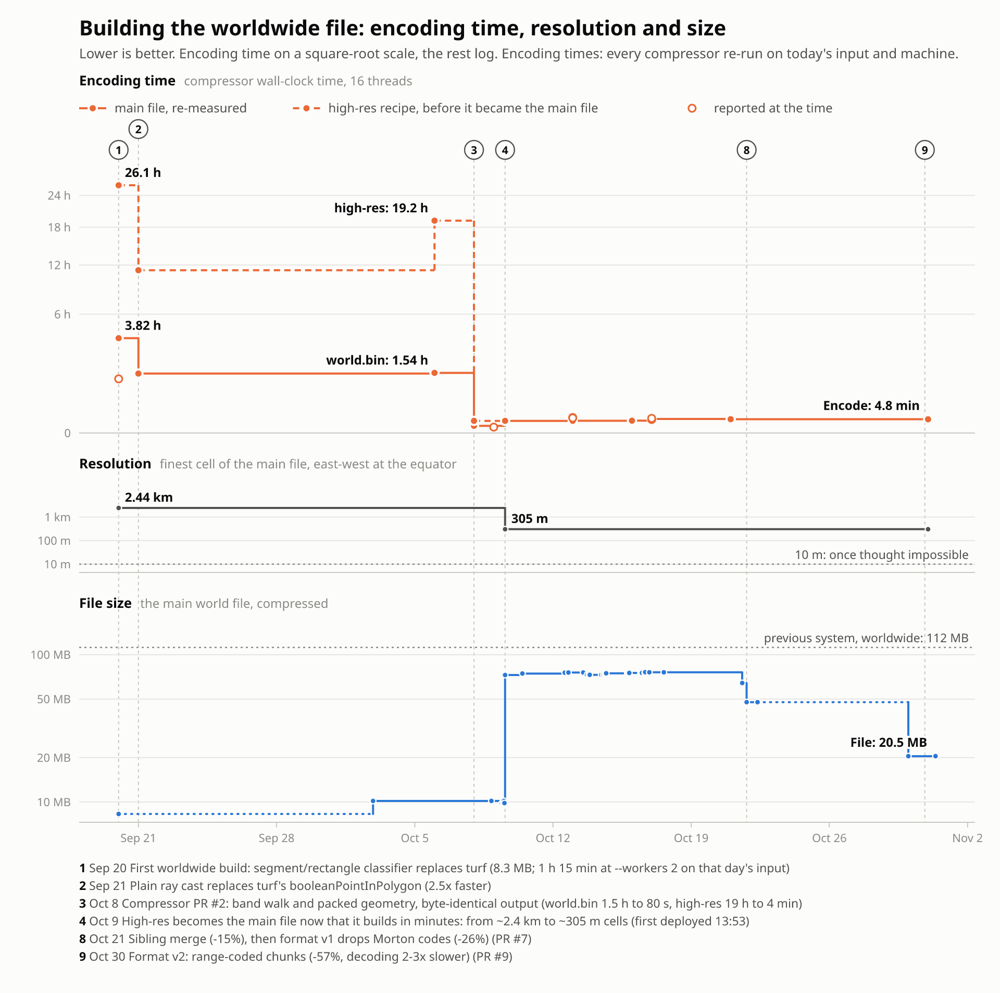

# Two fixes that took the geodata file from 72 MiB to 45 MiB

The worldwide [loc-to-city](https://github.com/ferrybig/loc-to-city) file went from 75,935,694 bytes (72.4 MiB) to 47,620,804 bytes (45.4 MiB), which is 37.3% smaller, with two changes to the file format. Measured on the real worldwide file, with percentages relative to the "before" row:

| Stage                 | Records     | Bytes                | MiB  |
| --------------------- | ----------- | -------------------- | ---- |
| before                | 166,081,761 | 75,935,694           | 72.4 |
| children merged back  | 106,377,942 | 64,244,778 (-15.4%)  | 61.3 |
| codes derived         | 110,148,645 | 47,620,804 (-37.3%)  | 45.4 |

Both changes came out of going over the draft of the first post that Claude wrote, and checking its claims against the data instead of taking them at face value. The rest of this post is how I found each of them, the table above is the whole result.

The chart below is the whole build history of the worldwide file. Event 8 is the pair of changes in this post, and event 9 is the change in the next post.

In the first post, [Compressing the cities of the world into a mere 45 MiB](/tech/compressing-the-world-into-megabytes), it explains what the tool does and what the file looks like at 72 MiB. After these two changes the chunks were still compressed with zlib, replacing that is the subject of [Beating zlib: the cities of the world in 19.5 MiB](/tech/beating-zlib-on-geodata).

## What a record is

Both changes are about the records that make up a chunk, so a short recap. A chunk is a square patch of the world. The compressor looks at which places overlap the patch, and if a boundary runs through it, cuts it into four and asks again for every part, down to a maximum depth. Every leaf cell becomes one record: a depth (how many times the patch was cut to get to this cell) and a palette index (which place the cell belongs to). The records are sorted by their [Morton code](https://en.wikipedia.org/wiki/Z-order_curve) and stored as two parallel arrays, all depths first and all palette indices after that.

## Merging the children back into their parent

The first fix is a recent change; I realised something important while writing the first post. Initially, **once a cell had been split, its children were never merged back.** Four siblings that all resolved to the same place stayed four records, even though the parent cell covers exactly the same ground and gives exactly the same answer.

I talked with Claude Opus about this, Opus didn't think it would be a significant improvement, because zlib's repeating value compression would see the pattern. My gut feeling was different. I hadn't thought about zlib, and merging four siblings into one record saves 75% of their records. After testing, on the worldwide file as it then stood, a single bottom-up merge pass would have removed 45,954,924 of 166,081,761 records.

After the merge cascades build finished, I realised that both Claude and I were wrong, because a merged parent can itself become one of four mergeable siblings, so even though the numbers didn't look great initially, the real reduction is **36.0% of the records, 166,081,761 down to 106,377,942**. And the file:

| Metric      | Before      | After                |
| ----------- | ----------- | -------------------- |
| records     | 166,081,761 | 106,377,942 (-36.0%) |
| bytes       | 75,935,694  | 64,244,778 (-15.4%)  |
| chunk bytes | 73,911,162  | 62,220,461 (-15.8%)  |

zlib's loss on the shortened runs is real but small next to the win from dropping a third of the varint deltas: 5,748 chunks got smaller, 15 got bigger. Lookups got faster too: a cold query in the densest chunk went from 17.9 ms to 9.5 ms, because there is a third less to decode.

The subtle part is the condition. It is not enough that four children each came back as a single record for the same place; they must each be a record *at the child depth*. A child that only one place touches a corner of also comes back as exactly one record, but a smaller and deeper one, and merging four of those hands the place all the empty cells in between. On the first worldwide build that invented 88,542 records of ocean, caught only because the output disagreed with an independent simulation by exactly that count.

## Do we actually need to store the Morton codes?

The example chunk from the first post, the patch of the world around Amsterdam (palette index 1) and Diemen (palette index 2), written out as two parallel arrays. The numbers on top are the Morton codes of the records:

|                     | 0 | 16 | 17 | 18 | 19 | 20 | 24 | 28 | 32 | 48 | 49 | 50 | 51 | 52 | 56 | 60 |
| ------------------- | - | -- | -- | -- | -- | -- | -- | -- | -- | -- | -- | -- | -- | -- | -- | -- |
| **depths**          | 1 | 3  | 3  | 3  | 3  | 2  | 2  | 2  | 1  | 3  | 3  | 3  | 3  | 2  | 2  | 2  |
| **palette indices** | 1 | 1  | 2  | 1  | 2  | 2  | 1  | 2  | 1  | 1  | 2  | 1  | 2  | 2  | 2  | 2  |

As I was reviewing [the Claude-drafted SVG](https://github.com/ferrybig/www.ferrybig.nl/blob/9bdd8b81b7d8c47672eddfd68d5b4732be2c08eb/content/tech/compressing-the-world-into-61-megabytes/quadtree-to-columns.svg) of the quadtree, I realised another aspect. Looking at the "array" section, the depth and the codes have a relationship. If depth is 1, the next code is 16. If depth is 2, it is 4. If depth is 3, it is 1. The only thing that ever broke the pattern was a gap, a stretch of unplaced cells between two records. Make the gap an explicit record instead of a silent skip, and there is nothing left for the codes array to say that the depths array does not already say: a reader can get a cell's code by walking the chunk and adding up depths as it goes.

That became [CGEODATA version 1](https://github.com/ferrybig/loc-to-city/pull/7): the codes array is gone, and an empty stretch of cells is now an explicit "no place" record instead of a silent skip. Measured on the real rebuilt file, not a prototype:

| Metric      | v0, codes stored | v1, codes derived   |
| ----------- | ---------------- | ------------------- |
| records     | 106,377,942      | 110,148,645 (+3.5%) |
| bytes       | 64,244,778       | 47,620,804 (-25.9%) |
| chunk bytes | 62,220,461       | 45,596,905 (-26.7%) |

The extra 3,770,703 records are the gaps, which used to cost nothing and now cost one record each. They are cheap anyway: a long run of identical depths and index-0 palette indices is exactly what zlib likes. Losing the codes array outright pays for them several times over.

I asked Claude to write a WebAssembly decoder for version 1 chunks, matching the one version 0 already had, then reverted it a day later. Measured across the whole file, deriving codes in WebAssembly instead of plain JavaScript saved about 16 microseconds per chunk, not enough to justify a second compiled decoder and its own fuzz tests. Version 0 files still decode through WebAssembly; version 1 does not. The honest cost of that shows up in a cold lookup: Paris, which used to resolve in 9.5 ms, now takes about 11 ms, because the arithmetic a compiled module used to do now runs as plain JavaScript on every chunk a query happens to land in. The file got smaller and a cold query got slower, in the same release. Even then, 13 ms is fast, considering how often geocoding happens.
